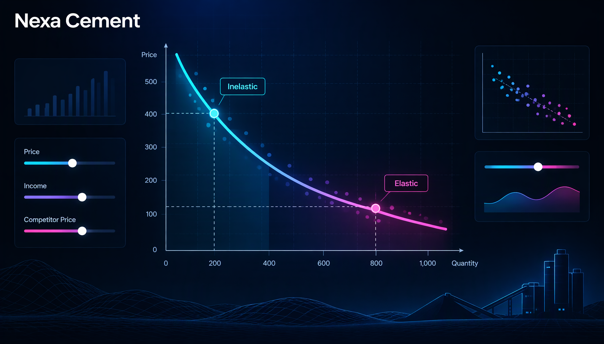

# Nexa Essentials — Price & Volume History Cockpit

A single-file, dependency-free analytics cockpit for a consumer/essentials business unit: every SKU sold since inception, with **realised price, volume and month-on-month change**, a **declared DP / TP / MRP** price grid, own-price **elasticity**, and a method-and-coverage section — all embedded as a JS data object and hand-rolled as inline SVG. No build, no server, no chart library; it opens straight from `file://`.



[](#) [](#) [](#)

## Quick start

```bash
open index.html      # macOS  ·  start index.html  (Windows)  ·  xdg-open index.html (Linux)
npx serve .          # or serve statically and open the printed URL
```

Self-contained; the only external request is the Fira Sans / Fira Code Google Fonts link, which falls back to system fonts offline.

## Tabs & features

- **Overview** — book-size KPIs, monthly revenue + active-SKU count, price-direction breadth, full-history insights, top-SKU price journey.
- **All SKUs** — 1,002-row sortable, searchable, filterable table (change-since-first, MoM price/volume, price-move counts, elasticity), click-to-drill.
- **SKU month-on-month** — per-SKU volume vs realised price (dual axis, toggleable legend) with declared DP / TP / MRP and realised/MRP reconciliation.
- **Price change tracker** — every distinct declared DP/TP/MRP point plus the largest realised MoM jumps.
- **Elasticity** — per-SKU own-price β (first-difference ln Q on ln P), price-volume scatter, and a plain-language read column.
- **Declared price grid** — DP/TP/MRP by SKU with dealer-margin, retail-headroom and realised-vs-TP gap.
- **Method & coverage** — source definitions, formulas and honest partial-coverage flags.

Shared hover tooltip across charts; deep-linkable tabs.

## Demo data

**All figures are synthetic placeholders for portfolio demonstration.** Revenue, price, volume, declared-price and elasticity values were randomised from the original patterns while preserving structure, record counts and order of magnitude, so every chart, table and KPI still renders realistically. Company, SKU and ERP identifiers are fictional. Nothing here is a real financial statement.

## Deploy

Import the folder into Vercel (preset: **Other**), leave the build command blank, output directory as root — the static `index.html` is served as-is.

## License

Portfolio demonstration artifact. Built by Abir.
